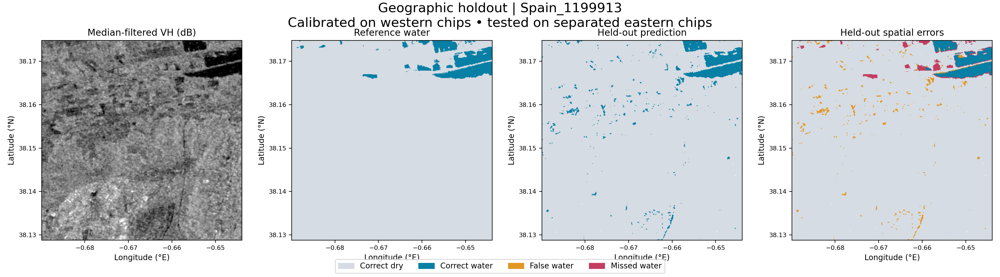

# Geographic holdout assessment

A second baseline improves on label-blind Otsu by calibrating a dual-polarization rule on western chips and assessing it on separated eastern chips. **The Otsu shortcomings were already observed before developing this model**, so this is a transparent development holdout, not a preregistered external validation or an untouched final test set.

Split depends only on longitude: the 60th percentile of chip center longitudes defines the cutoff (-0.712903°); training chips must lie wholly west of cutoff −0.01°, and test chips wholly east of cutoff +0.01°. Chips crossing the buffer are excluded. This prevents direct spatial overlap across calibration/test domains, although regional dependence remains.

- Calibration chips: 17
- Test chips: 8
- Buffer exclusions: 5
- Fitted VV threshold: -15.5 dB; VH threshold: -22.0 dB

A fixed 3×3 median filter is applied independently to VV and VH. Water requires both smoothed channels below their cutoffs. Grid search maximizes F1 on a fixed every-other-row/column calibration sample. Grid: VV −25 to −8 dB and VH −32 to −12 dB, both at 0.5 dB steps. No test labels are passed to the calibration routine. No further model selection or tuning follows these test results.

| Held-out metric | Estimate | Tile-bootstrap 95% interval |
|---|---:|---:|
| precision | 0.945 | 0.684–0.976 |
| recall | 0.937 | 0.809–0.974 |
| F1 | 0.941 | 0.752–0.973 |
| IoU | 0.889 | 0.602–0.947 |

Otsu evaluated on these same test chips: F1 = 0.531, IoU = 0.362. This controls the comparison domain; the all-chip Otsu summary covers a different footprint.

The illustrated chip is the westernmost test chip, selected without its accuracy. Full assignments and metrics are in `outputs/holdout/metrics.json`; test predictions and error GeoTIFFs are in the same folder. Metrics apply to surface water, not independently validated new flooding. Calibration F1 is an in-sample fit score, not reported as test accuracy.
