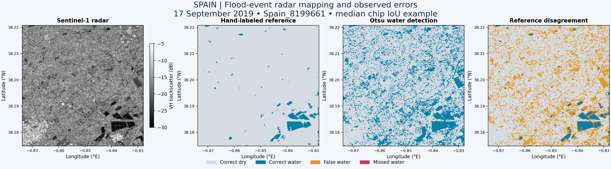
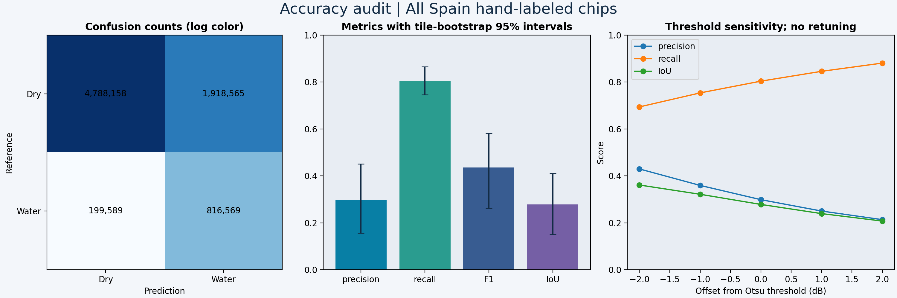
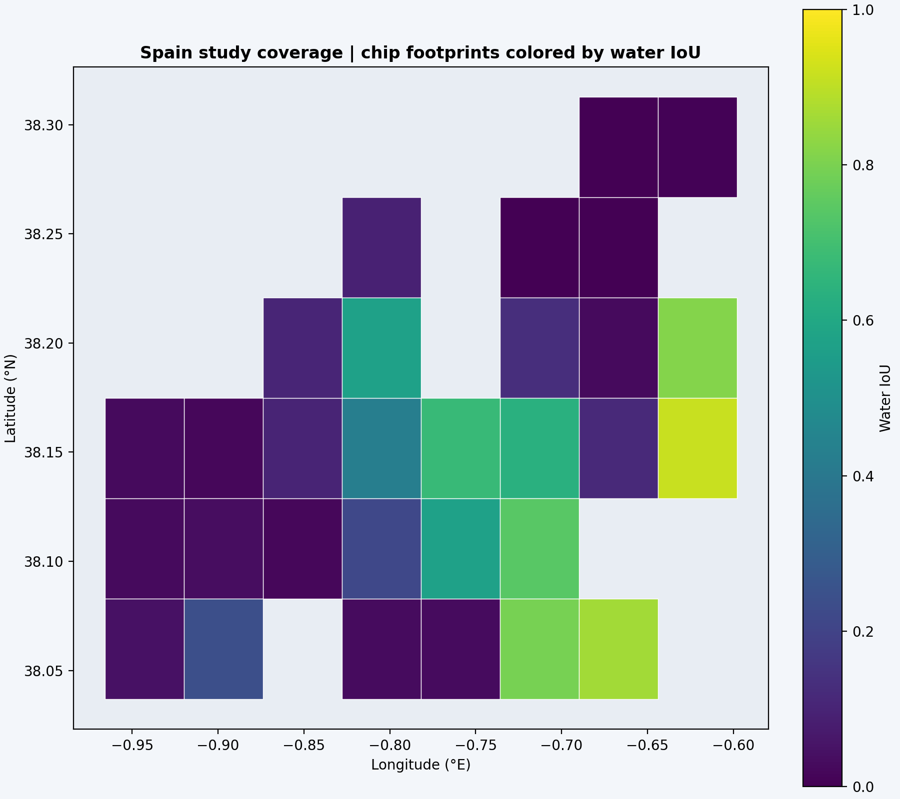

# Spain flood-event mapping: results

Status: executed exploratory benchmark. **This simple baseline overpredicts water substantially; its mapped area is not a reliable flood-area estimate.** Radar acquisition: **17 September 2019**; optical reference acquisition in event metadata: **18 September 2019**.

## Results

All **30 available Spain hand-labeled chips** were processed. The primary method is label-blind, per-chip Otsu thresholding of Sentinel-1 VH backscatter. No hand labels or published event threshold are used to set the classifier.

| Metric | Estimate | Tile-bootstrap 95% interval |
|---|---:|---:|
| precision | 0.299 | 0.156–0.451 |
| recall | 0.804 | 0.745–0.865 |
| F1 | 0.435 | 0.262–0.582 |
| IoU | 0.278 | 0.150–0.410 |
| accuracy | 0.726 | 0.675–0.774 |

## Area accounting

These are sums across sampled chip footprints, **not the total flood extent of Spain or the event**. Reference-domain totals exclude ignored labels; full mapping totals include radar-valid pixels with ignored labels.

- mapped_water_km2: **214.853 km²**
- reference_domain_predicted_km2: **214.714 km²**
- reference_water_km2: **79.792 km²**
- potential_flood_km2: **185.235 km²**

## Interpretation and limits

The validated target is event-time **surface water**, including permanent water. `potential_flood` subtracts the supplied JRC permanent-water mask, but its accuracy is NOT independently established as new flooding: seasonal water, changing shorelines, and JRC omissions can remain. No pre-event Sentinel-1 change-detection claim is made.

The hand labels are an independent annotation source, not field survey truth. The one-day radar/optical timing difference can create real disagreement. Cloud-obscured/ambiguous reference pixels are excluded. Spatial dependence remains between nearby chips; tile bootstrap intervals describe this sampled set, not national or future-event generalization. Overall accuracy can be inflated by the dry majority; prioritize water precision, recall, F1, and IoU.

Dark terrain/shadow, smooth bare soil, radar speckle, wind-roughened water, buildings, and flooded vegetation are expected failure modes. A single threshold cannot resolve them reliably. Maps explicitly show false positives and missed water. No confidence-probability layer is claimed.

Road/building exposure is not calculated in this release because no dated, verified infrastructure inventory has been ingested. No damage claims are supported. Before operational use, add same-orbit pre-event imagery, terrain/shadow masking, independent new-flood reference labels, and a dated infrastructure layer.

## Audit trail

See `outputs/metrics.json`, `outputs/per_chip.csv`, `manifest.json`, `METHODS.md`, and `VALIDATION.md`. The sensitivity figure reports ±1/±2 dB perturbations without choosing a best threshold after looking at reference accuracy. The illustrative chip is selected by median IoU; all chips contribute to reported results.

## Calibrated model with geographic holdout

See [HOLDOUT.md](HOLDOUT.md) for a separate calibration/test experiment with a spatial buffer and explicit development-history disclosure.
