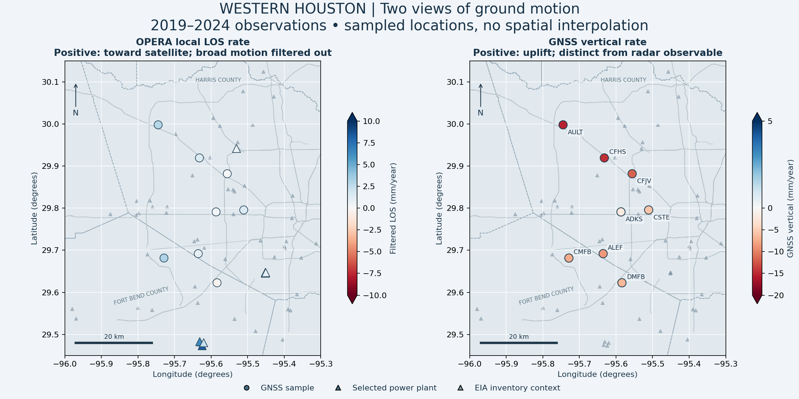
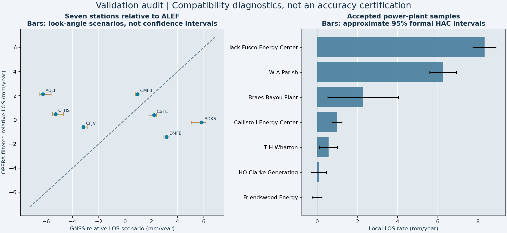

# 02 · Western Houston: local deformation and GNSS audit

**Executed exploratory pilot for the land-subsidence project.** This release contains real OPERA DISP-S1 point observations, GNSS time series, infrastructure overlays, formal trend uncertainties, and viewing-direction checks. It is **not a validated absolute-subsidence product**: the public radar service exposes short-wavelength LOS displacement, not the full-band displacement or precise look vectors needed for that claim.

[Results and maps](RESULTS.md) · [Methods](METHODS.md) · [Validation](VALIDATION.md) · [Sources](SOURCES.md) · [Full-band completion requirements](NEXT_STEPS.md)





## Deliverables

- Four scientific figures: sampled maps, time series, GNSS/infrastructure audit, uncertainty/geometry sensitivity.
- GeoJSON of measured sample locations; no interpolation into a continuous raster.
- Per-site radar and GNSS rates, monthly/epoch time series, reference-date graph diagnostics, exclusion logs, and geometry-scenario tables.
- Frozen observation tables, source checksums, reproducible code, and tests.

## Reproduce the committed analysis

```bash
python -m pip install -r projects/02-subsidence-houston/requirements.txt
python projects/02-subsidence-houston/analyze.py
python -m unittest discover -s projects/02-subsidence-houston/tests -v
```

`analyze.py` uses the committed input snapshots and does not require login or network access. To acquire a **new source snapshot**, run `acquire.py` and then `prepare.py`; that may change inputs as upstream services evolve. Preserve the previous manifest and results before refreshing.
