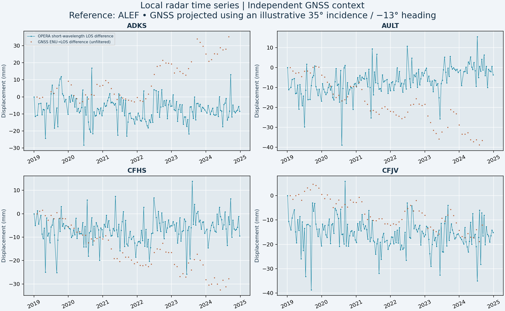
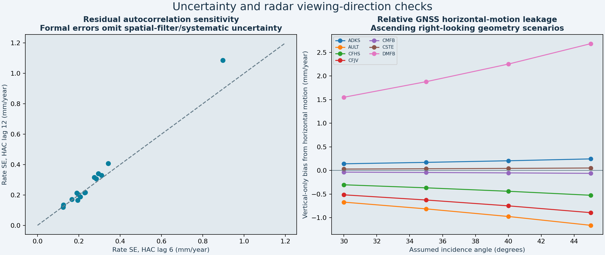

# Results: western Houston local deformation

**Executed exploratory study, not a validated absolute-subsidence map.** All radar observations are real OPERA DISP-S1 measurements returned by ASF's public point service. The available observable is **short-wavelength line-of-sight (LOS) displacement**, which suppresses spatial wavelengths above approximately 30 km. It cannot recover broad regional subsidence or unique vertical motion.

The study uses 2019–2024 observations at eight GNSS stations and the eight largest EIA power-plant inventory locations in the bounding box, ranked by reported capacity before radar retrieval. Seven power-plant sites passed the minimum data gate; one was excluded for insufficient valid epochs. The 58-plant inventory snapshot is February 2025, so infrastructure presence throughout 2019–2024 is not assumed.

## Observed local radar trends

Positive values indicate movement toward the satellite, not necessarily uplift. Negative values indicate movement away, not necessarily subsidence. Rates include local spatial-filter residuals. The maps plot measured sample locations without interpolation.

| Site | Kind | LOS rate (mm/yr) | Formal HAC SE (mm/yr) | Epochs |
|---|---|---:|---:|---:|
| ADKS | GNSS | 0.36 | 0.31 | 175 |
| ALEF | GNSS | 0.89 | 0.28 | 175 |
| AULT | GNSS | 2.89 | 0.19 | 175 |
| CFHS | GNSS | 1.38 | 0.23 | 175 |
| CFJV | GNSS | 0.15 | 0.27 | 175 |
| CMFB | GNSS | 3.09 | 0.19 | 175 |
| CSTE | GNSS | 1.45 | 0.21 | 175 |
| DMFB | GNSS | -0.39 | 0.17 | 175 |
| T H Wharton | power_plant | 0.57 | 0.23 | 175 |
| W A Parish | power_plant | 6.27 | 0.34 | 175 |
| Jack Fusco Energy Center | power_plant | 8.32 | 0.29 | 175 |
| Friendswood Energy | power_plant | 0.00 | 0.12 | 175 |
| HO Clarke Generating | power_plant | 0.08 | 0.20 | 132 |
| Braes Bayou Plant | power_plant | 2.29 | 0.90 | 145 |
| Callisto I Energy Center | power_plant | 0.99 | 0.13 | 175 |

## GNSS comparison and error checks

The conditional, geometry-scenario comparison at seven GNSS stations relative to ALEF has RMS mismatch **4.96 mm/yr** and mean mismatch **0.78 mm/yr**. **These are compatibility diagnostics, not an independent radar accuracy estimate**: the radar field is spatially filtered, GNSS is not; exact per-pixel look vectors were unavailable. No GNSS correction was fitted to the radar values.

The diagnostic fits use identical available calendar months for both instruments and both stations; radar epochs are reduced to monthly medians for this comparison. The same reference station appears in each difference, so diagnostic residuals are correlated. GNSS monthly medians require at least 15 accepted daily solutions; daily up uncertainty above 30 mm is excluded. Known step months are omitted and eligible documented steps enter the GNSS trend regression. Reported formal HAC errors quantify fitted residual behavior, not all systematic uncertainty.

## What is supported

- Reproducible, source-identified OPERA point observations and local LOS trend estimates at real infrastructure coordinates.
- Independent GNSS vertical and horizontal trend estimates, with equipment-step and data-coverage checks.
- Explicit reference-date, graph-connectivity, mask, coordinate, projection-sign, and uncertainty-sensitivity checks.

## What remains unvalidated

Absolute subsidence, full-band displacement, a continuous 30 m rate map, pixelwise incidence/heading, and damage or structural condition are not established. The point service does not expose the full recommended-mask rationale, coherence arrays, or physical displacement uncertainty layers. Formal rate intervals must not be used as complete uncertainty bounds.

To complete a full-band subsidence/accuracy study, obtain authenticated full OPERA NetCDF and matching STATIC geometry, apply matching spatial/temporal referencing and filtering to GNSS, and compare projected ENU with the unfiltered LOS field. A second viewing geometry is required for meaningful decomposition unless a documented horizontal-motion assumption is justified. Do not extrapolate these trends into future damage or plant failure.

See [METHODS.md](METHODS.md), [VALIDATION.md](VALIDATION.md), [SOURCES.md](SOURCES.md), and the CSV/GeoJSON/JSON outputs for the complete audit trail.
